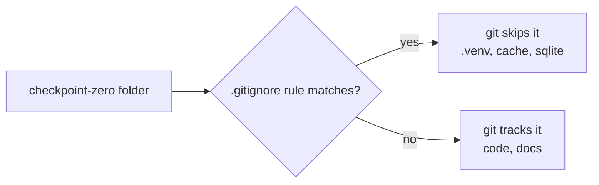
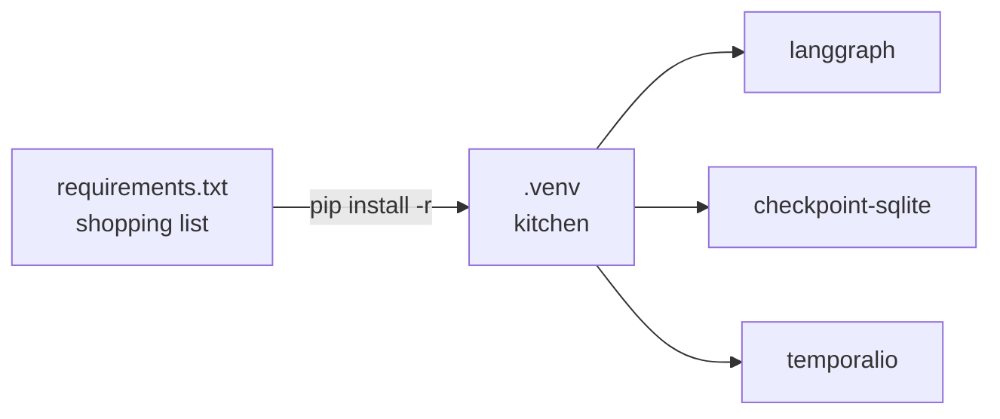
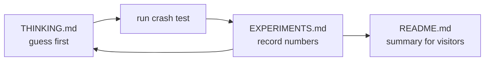
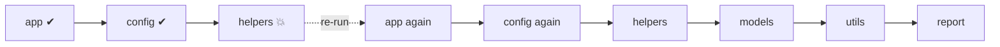
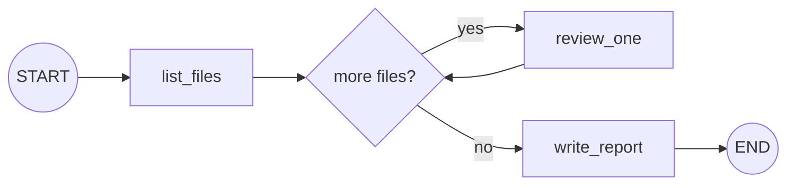
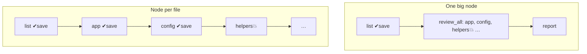
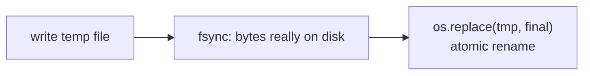
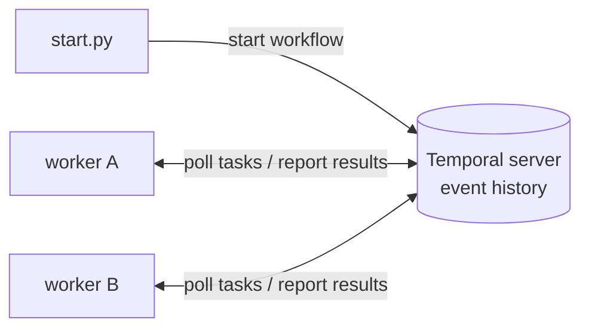

# Learning Notes: checkpoint-zero

My notes, one section per step, written simply.

---

## Stage 0 · Step 1: `.gitignore`

**Idea:** git takes snapshots of my project. `.gitignore` lists things git should skip,
like leaving the hotel shampoo out of the suitcase.

**What I ignore and why:**
- `.venv/`: my project's private library toolbox. It's huge and anyone can rebuild it.
- `__pycache__/`, `*.pyc`: speed-up files Python makes on its own.
- `*.sqlite`, `*.db`, `output/`: files the benchmark *creates* when it runs. They're results, not source code.

**Gotcha:** `#` is only a comment at the *start* of a line. `*.db  # note` would break the pattern.

**Check it works:** `git check-ignore -v .venv/` prints which rule is ignoring it.



---

## Stage 0 · Step 2: `requirements.txt`

**Idea:** `.venv` is the kitchen, `requirements.txt` is the shopping list.
Anyone runs `pip install -r requirements.txt` and gets the same ingredients.

**Pinning:** `langgraph==1.2.14` means *exactly* this version, so results don't change
when a library updates next month.

| Package | Stage | Job |
|---|---|---|
| langgraph | 2–5 | job as a graph |
| langgraph-checkpoint-sqlite | 3 | save progress to SQLite |
| temporalio | 6–7 | Temporal workflows |

**Wildcards (from the Step 1 quiz):** `*.sqlite` matches *any* name ending in `.sqlite`,
so `checkpoints.sqlite` is ignored by `.gitignore` line 10.



---

## Stage 0 · Step 3: `target_repo/` (the fake crime scene)

**Idea:** like a fire drill with fake smoke. Known bugs mean we know the right answer: **3 findings**.

| File | Status | Why |
|---|---|---|
| app.py | 🔴 bug | `eval(user_input)`: code injection |
| utils.py | 🔴 bug | `shell=True`: command injection |
| config.py | 🔴 bug | `API_KEY = "FAKE_..."`: hardcoded secret |
| models.py | 🟢 clean | |
| helpers.py | 🟢 near miss | safe `subprocess.run([...])`, list and no shell |

**Surprise:** a quick `grep` found **5** hits, because comments also mention `eval(` and
`shell=True`. Those are **false positives**. Fix this in Stage 1 by skipping comment lines.

---

## Stage 0 · Step 4: README / THINKING / EXPERIMENTS

- **README.md** = poster (what it is, how to run)
- **THINKING.md** = lab notebook (guesses *before* testing + design decisions)
- **EXPERIMENTS.md** = results table (one row per crash test)



**Stage 0 interview question:** *Why pin dependency versions in a benchmark?*
> So the results come from my code, not from a library that quietly changed. With `==` pins,
> anyone who runs it next year installs the exact same versions and should get the same numbers.

---

# Stage 1: Plain script (`v1_plain/run.py`)

**Analogy:** writing an essay in an editor with no save button. The power goes out and you start again.

**How it works:** a `for` loop reviews 5 files, keeping findings in a Python list (in RAM). The list
only becomes a report at the very end. `kill -9` (SIGKILL) ends the process instantly, and RAM is wiped.



**Result:** 2 finished reviews thrown away, total 22.7 s instead of ~15 s.

**Shared pieces (`common/review.py`), used by every version:**
- `review_file()` runs 3 regex rules on each non-comment line, then sleeps 3 s (the fake LLM).
- `log_event()` appends a JSON line (`review_start`, `review_done`, …) to `output/events.jsonl`. This is how we *measure*.
- `maybe_crash(point)` makes the process kill itself if env var `CRASH_AT` equals `point`.

**Interview question:** *What does `kill -9` do differently from Ctrl+C?*
> Ctrl+C sends SIGINT, which a program can catch and clean up after. `kill -9` sends SIGKILL, which
> the OS enforces instantly: no cleanup, no `finally` blocks. It's the honest way to simulate a power
> cut or an out-of-memory kill, so it's the right test for crash recovery.

---

# Stage 2: LangGraph basics (`v2_langgraph/graph.py --checkpointer none`)

**Analogy:** a board game. The **state** is the board, **nodes** are the moves, and **edges** say which move comes next.

- **State**: a dictionary passed from node to node (`run_id`, `files`, `index`, `findings`).
- **Node**: a Python function that takes the state and returns the parts it changed.
- **Edge**: "after node X, go to node Y". A **conditional edge** picks the next node with a function (`more_files`).



**Result:** with no checkpointer, it behaved exactly like the plain script (2 finished reviews lost).
The graph only organizes the steps. It doesn't save anything by itself.

**Interview question:** *What does LangGraph give you without a checkpointer?*
> Structure: clear steps, explicit branching and loops, and state passed between steps. But no
> durability. If the process dies, the state in memory dies with it.

---

# Stage 3: Checkpoints (`--checkpointer sqlite`)

**Analogy:** a video game save point. After each level (node), the game writes your progress to disk.

- **Checkpointer (`SqliteSaver`)**: after every node, it writes the whole state into a SQLite file (`output/langgraph_checkpoints.sqlite`).
- **thread_id**: the name of the save slot. We use the run id. Same thread_id = same save.
- **Resume**: `graph.invoke(None, config)`. `None` means "don't start new, continue from the save".
  `graph.get_state(config).next` tells you which node is due next.

```
crash run:  list ✔save → app ✔save → config ✔save → helpers 💥
resume:                                             helpers → models → utils → report
```

**Catch:** *you* must notice the crash and re-run the command. LangGraph never restarts itself.

**Interview question:** *What exactly is saved in a LangGraph checkpoint, and when?*
> The full graph state plus which node runs next, saved after each step (superstep) finishes.
> Nothing is saved *during* a node, so work inside a node that hasn't returned yet is lost on a crash.

---

# Stage 4: Granularity (`--granularity big` vs `per-file`)

**Analogy:** saving your game only at the end of a 5-level world vs after every level.

| Design | Save points | Lost on crash mid-file-3 |
|---|---|---|
| one big node `review_all` | before it, after it | files 1, 2 (+3 in progress) |
| node per file `review_one` | after every file | only file 3 in progress |



**Result:** big node lost 2 finished reviews (same as no checkpointer!). Per-file lost 0.
**Rule:** worst-case loss = the size of your biggest step.

**Interview question:** *Why not checkpoint after every single line, then?*
> Each save costs time and disk writes, and the state grows. You pick a step size where the work
> lost in a crash is acceptable compared with the saving overhead. Usually that's one expensive call (an LLM or API call) per step.

---

# Stage 5: Idempotent report (`--report naive` vs `atomic`)

**Analogy:** posting a letter, then fainting before you tick "posted" on your to-do list. When you wake up, the list says "not posted", so you post it again. Now your friend has two letters.

The crash window: the side effect (writing the report) happened, **but** the checkpoint (node finished) didn't.
On resume, LangGraph re-runs `write_report`.

- **naive**: appends a line to `reports_naive.jsonl`, so the repeat creates a **duplicate line**. ❌
- **atomic**: writes `report_<run_id>.json.tmp`, flushes it to disk, then `os.replace()` renames it to `report_<run_id>.json`. The repeat overwrites the same file with the same content. ✅



- **Idempotent**: doing it twice has the same effect as doing it once.
- **Atomic**: happens all at once or not at all, never half-done.

**Interview question:** *Your workflow engine checkpoints every step. Can a step still run twice?*
> Yes. If the crash lands after the step's side effect but before the checkpoint is saved, the step
> re-runs. Checkpointing gives at-least-once execution, so side effects must be idempotent: key them
> by a run id and use overwrite or upsert instead of append.

---

# Stage 6: Temporal (`v3_temporal/`)

**Analogy:** a restaurant. The **server** is the order board (it remembers every order and what's done).
**Workers** are cooks. If a cook collapses, the order is still on the board and another cook picks it up.

| Piece | File | Job |
|---|---|---|
| **Activity** | `activities.py` | one real-world step (review a file). Can be retried. |
| **Workflow** | `workflow.py` | the recipe: the order of activities. Must be deterministic. |
| **Worker** | `worker.py` | process that polls the server and runs workflow and activity code |
| **Starter/client** | `start.py` | asks the server to start a workflow, waits for the result |
| **Event history** | (on the server) | every finished activity's result, i.e. the "saves" |



**Replay:** when a new worker picks up the workflow, it re-runs the workflow function from the top,
but each `execute_activity` already in history returns the saved result instantly instead of running again.
That's why workflow code must be **deterministic** (no random numbers or real clock reads in the workflow itself).

**Interview question:** *Why must Temporal workflow code be deterministic?*
> Recovery works by replaying the workflow code against the recorded history. If the code made
> different decisions on replay (random, current time), it wouldn't match the history and Temporal
> couldn't safely fast-forward. Anything non-deterministic belongs in an activity.

---

# Stage 7: Temporal crash tests

`kill -9` on the worker halfway through `helpers.py`. Note that **nobody runs a resume command**: a fresh worker just starts.

**How does the server know the worker died?** It doesn't, directly. It relies on timeouts:
- **start_to_close_timeout (20 s)**: the max time for one attempt. No heartbeat → the server waits the full 20 s. Measured gap: **19.5 s**.
- **heartbeat_timeout (2 s)**: the activity pings "still alive" every 0.5 s. Pings stop → retry after ~2 s. Measured gap: **2.0 s**.
- **RetryPolicy**: after a timeout, retry (attempt 2, 3, …) with `initial_interval=1 s`, up to 5 attempts. The event log shows `attempt=2` on the retry.

```
no heartbeat:  helpers start ─ 💥 ──────── 20 s timeout ─────────▶ retry
heartbeat 2s:  helpers start ─ 💥 ─ 2 s ─▶ retry
```

**Surprise (sticky queue):** after the retry, the workflow paused ~10 s. The dead worker had the
workflow cached and the server first offered it the next task, waiting out a 10 s timeout. See THINKING.md.

**Report crash:** killing the worker right after the report was written, Temporal retried the
`write_report` activity (2 writes), but the atomic writer made it harmless. Same lesson as Stage 5.

**Interview question:** *A Temporal worker is killed mid-activity. Walk me through recovery.*
> The server has the workflow's history but doesn't know the worker died. When the activity's
> heartbeat timeout (or start-to-close timeout if there's no heartbeat) expires, the server marks the
> attempt failed and schedules a retry under the retry policy. Any live worker polling that task queue
> picks it up. Finished activities are in history, so they aren't re-run. Recovery time ≈ the timeout,
> which is why long activities should heartbeat.

---

# Stage 8: The big comparison

| | Plain script | LangGraph + SQLite | Temporal |
|---|---|---|---|
| Saves progress | ❌ | ✅ after each node | ✅ after each activity |
| Lost finished work (per-file steps) | all of it | 0 | 0 |
| Who resumes | you, from scratch | you, same thread_id | automatic (any worker) |
| Detects crash | – | – (you notice) | via timeouts and heartbeats |
| Extra infrastructure | none | a SQLite file | a server + worker processes |
| Steps can repeat? | everything repeats | yes, at-least-once | yes, at-least-once |

**Final interview question:** *When would you pick LangGraph checkpoints vs Temporal?*
> LangGraph checkpoints suit a single agent process where a human or simple supervisor can re-run it,
> and you want light setup (just a SQLite file). Temporal suits long-running or business-critical jobs
> that must resume on their own across machines, with retries, timeouts and full history, at the cost of
> running a server and workers. Either way, steps can repeat, so side effects must be idempotent.
