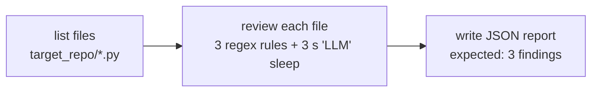
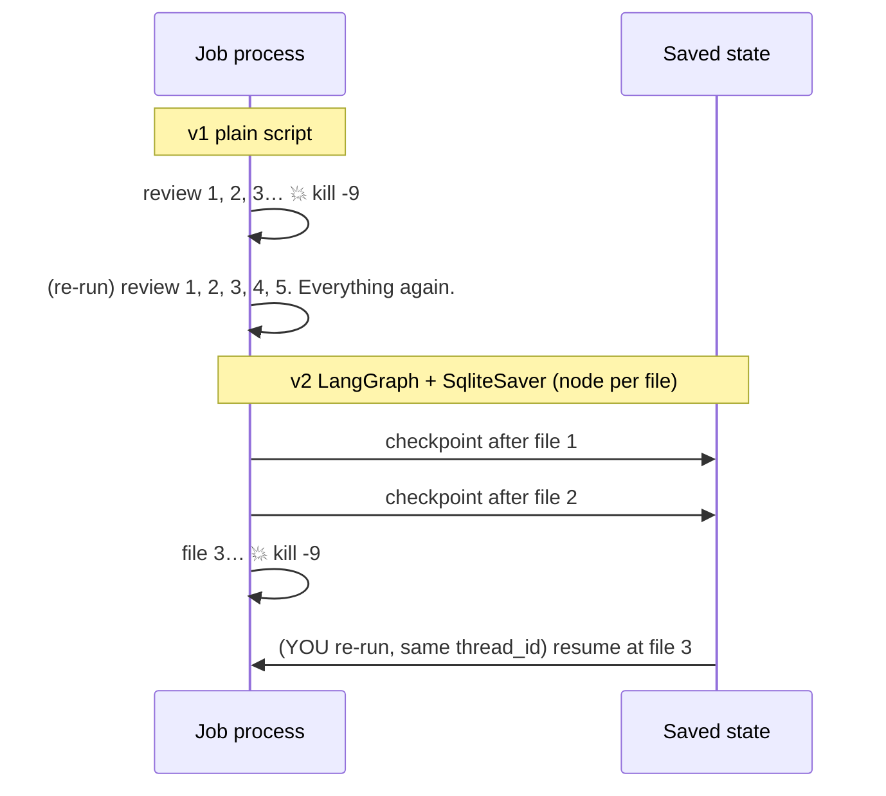
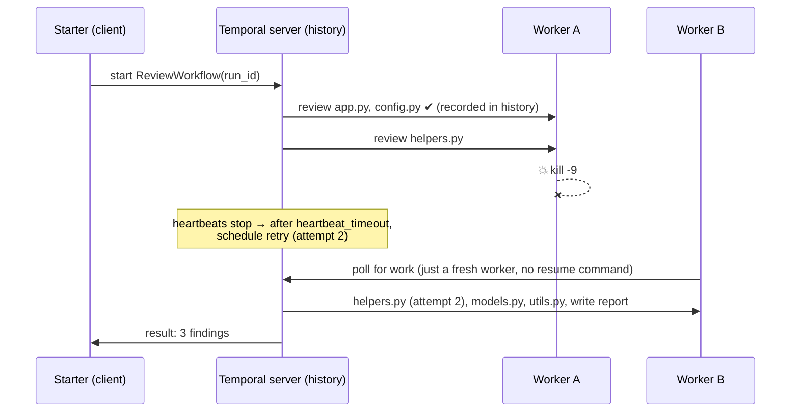

# checkpoint-zero

A benchmark that runs the **same security review job** three ways, crashes each one
on purpose with `kill -9`, and measures how much work each loses.

| # | Version | Saves progress? | Who resumes after a crash? |
|---|---|---|---|
| 1 | Plain Python script | No | Nobody: starts over |
| 2 | LangGraph + SQLite checkpoints | After every node | You (re-run with the same `thread_id`) |
| 3 | Temporal | After every activity | The Temporal server, automatically |

## Headline results ([full table](EXPERIMENTS.md))

Killed halfway through file 3 of 5 (3 s per file):

| Version | Finished reviews thrown away | Recovery |
|---|---|---|
| Plain script | 2 | manual, from scratch |
| LangGraph, one big node | 2 | manual, but the save point was *before* the big node |
| LangGraph, node per file | **0** | manual, from the last finished file |
| Temporal, no heartbeat | **0** | automatic after 19.5 s (start-to-close timeout) |
| Temporal, 2 s heartbeat | **0** | automatic after **2.0 s** |

And a crash right after writing the report: an *appending* writer produced a **duplicate**;
the *atomic, run-id-keyed* writer did not.

## The job



`target_repo/` contains deliberately vulnerable code (`eval`, `shell=True`) and a **FAKE** key.
It is only read as text, never executed.

## How each version recovers





## Layout

```
common/review.py        shared job logic + event log + crash hook (same code for every version)
v1_plain/run.py         version 1
v2_langgraph/graph.py   version 2  (--checkpointer none|sqlite, --granularity big|per-file, --report naive|atomic)
v3_temporal/            version 3  (activities.py, workflow.py, worker.py, start.py)
experiments/            crash_test.py (scenarios), measure.py (counts lost work), export_timeline.py (data for the visual replay)
target_repo/            the 5 fixture files being reviewed
```

## Run it

```bash
python3 -m venv .venv
.venv/bin/pip install -r requirements.txt

# v1 / v2: just run (re-run the same command + --run-id to resume v2)
.venv/bin/python -m v1_plain.run --run-id demo1
.venv/bin/python -m v2_langgraph.graph --run-id demo2

# v3: three terminals
temporal server start-dev                         # 1. server (UI at http://localhost:8233)
.venv/bin/python -m v3_temporal.worker            # 2. worker
.venv/bin/python -m v3_temporal.start --run-id demo3 --heartbeat 2   # 3. start + wait

# all crash experiments (needs the Temporal server running)
.venv/bin/python -m experiments.crash_test all
```

Set `REVIEW_DELAY=0.2` for fast runs. Outputs go to `output/` (git-ignored).

See also: [EXPERIMENTS.md](EXPERIMENTS.md) (numbers), [THINKING.md](THINKING.md) (hypotheses and design),
[LEARNING.md](LEARNING.md) (step-by-step notes), [GLOSSARY.md](GLOSSARY.md).
